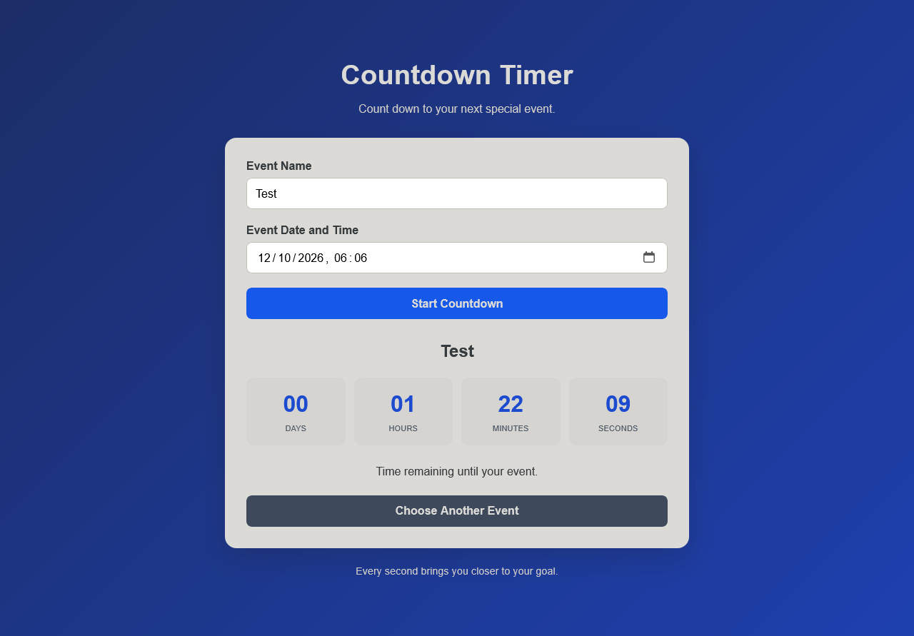

# ⏳ Countdown Timer

A simple and responsive web application that counts down the time remaining until a specific event. Built with HTML, CSS, and JavaScript to practice date and time manipulation, DOM updates, and timed functions.

## 📌 About the Project

The **Countdown Timer** is a web application that allows users to create a countdown for a future event by entering an event name and selecting a target date and time.

The application displays the remaining time in days, hours, minutes, and seconds, updating automatically every second until the event arrives.

This project was developed to strengthen fundamental web development skills and explore JavaScript's date and time functionality.

## ✨ Features

- [x] Enter a custom event name.
- [x] Select a target date and time.
- [x] Display the remaining days, hours, minutes, and seconds.
- [x] Update the countdown automatically every second.
- [x] Validate event names and future dates.
- [x] Display a message when the event arrives.
- [x] Reset the application to choose another event.
- [x] Responsive layout for different screen sizes.

## 🛠️ Technologies Used

- **HTML5:** Structures the application and its forms.
- **CSS3:** Provides styling, layout, and responsive design.
- **JavaScript:** Handles date calculations, input validation, DOM manipulation, and countdown updates.
- **Git and GitHub:** Version control and source code hosting.

## 📂 Project Structure

```text
Countdown-Timer/
│
├── index.html
├── style.css
├── script.js
└── README.md
```

## 🚀 Getting Started

### Prerequisites

You only need a modern web browser. Visual Studio Code and the Live Server extension are optional.

### 1. Clone the Repository

```bash
git clone https://github.com/YOUR-USERNAME/Countdown-Timer.git
```

### 2. Navigate to the Project Directory

```bash
cd Countdown-Timer
```

### 3. Run the Application

Open the `index.html` file directly in your browser or use the Live Server extension in Visual Studio Code.

No additional dependencies or build tools are required.

## ⚙️ How It Works

The application calculates the difference between the selected event date and the current time.

JavaScript converts this difference into days, hours, minutes, and seconds, then updates the interface every second using `setInterval()`.

When the remaining time reaches zero, the countdown stops and displays a completion message.

### Main JavaScript Concepts

- **Date and time manipulation:** Handles the target date and current time.
- **Timestamps:** Represents dates as milliseconds since the Unix epoch.
- **`Date.now()`:** Retrieves the current timestamp.
- **`Math.floor()`:** Calculates whole units of time.
- **`setInterval()`:** Updates the countdown at regular intervals.
- **`clearInterval()`:** Stops the countdown when necessary.
- **`addEventListener()`:** Handles form submission and button clicks.
- **DOM manipulation:** Updates the timer display dynamically.
- **Input validation:** Prevents empty event names and invalid or past dates.

## 🎯 Learning Objectives

This project helps develop practical skills in:

- JavaScript fundamentals.
- Functions and variables.
- Date and time calculations.
- Timestamps and time intervals.
- DOM manipulation.
- Event handling.
- Form validation.
- Responsive web design.
- Code organization and documentation.

## 🔮 Future Improvements

Possible improvements for future versions include:

- [ ] Save events using `localStorage`.
- [ ] Support multiple countdown timers.
- [ ] Add pause and resume functionality.
- [ ] Add sound notifications when an event arrives.
- [ ] Implement customizable themes for different events.
- [ ] Add a feature to share countdowns.
- [ ] Display a progress bar until the target date.
- [ ] Implement automated tests.

## 📸 Screenshots



## 👨‍💻 Author

**Lucas Neves**

This project was developed for educational purposes and as part of my software development portfolio.

## 📄 License

This project can be distributed under the MIT License. To use this license, add a `LICENSE` file to the repository containing the full license text.

---

⭐ If you found this project useful, consider giving the repository a star!

**Built with HTML, CSS, and JavaScript. 💻**
